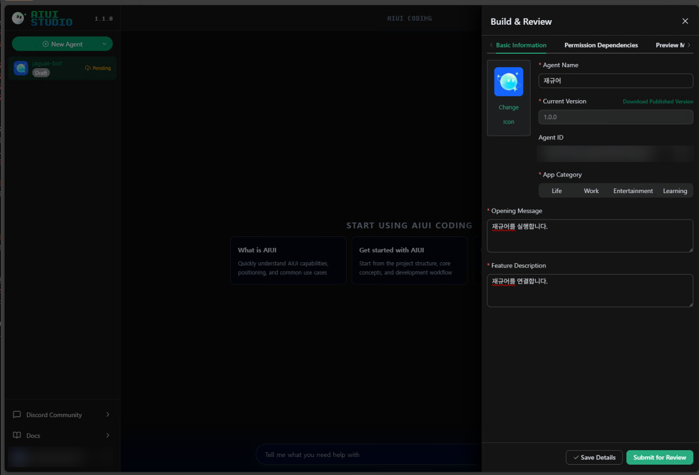
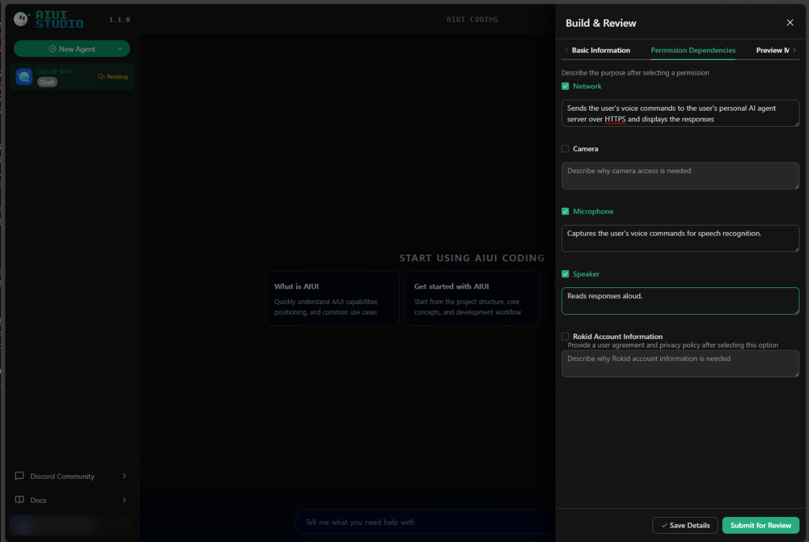
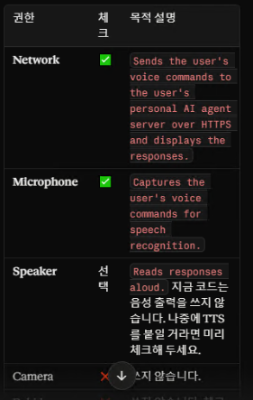
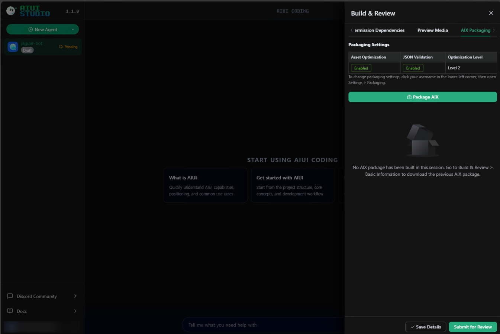
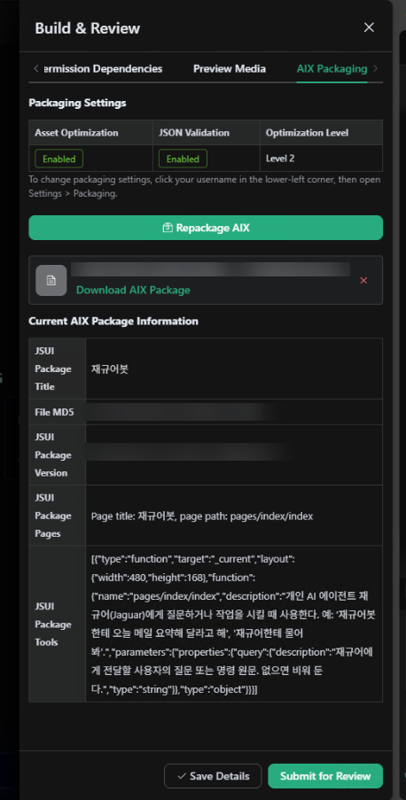
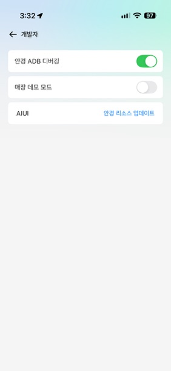

# Rokid 스마트 안경 × Hermes Agent 연동 가이드

Rokid 안경에 "하이 로키드, 재규어 실행"이라고 말하면, 내 PC/서버에서 돌아가는 개인 AI 에이전트(Hermes Agent)가 응답해 주도록 만드는 방법입니다.

> 이 문서는 **개인용(비배포) 앱** 기준입니다. Rokid 스토어에 공개 배포하는 방법은 다루지 않습니다.

## 전체 구조

```
Rokid 안경 ──(음성 → 텍스트)──> AIUI 앱(.aix)
                                    │  HTTPS (443)
                                    ▼
                    공유기/NAS 역방향 프록시 (DDNS 도메인 + 인증서)
                                    │  HTTP (내부망)
                                    ▼
                    Hermes Agent API 서버 (PC, 포트 8643)
                                    │
                                    ▼
                         답변 텍스트 → 안경 화면에 표시
```

핵심 제약: **AIUI Studio는 HTTPS 주소만 허용**합니다. 그래서 Hermes의 HTTP 포트를 그대로 쓸 수 없고, 인증서가 붙은 역방향 프록시가 반드시 필요합니다.

## 준비물

| 항목 | 설명 |
|---|---|
| Rokid 안경 + Rokid 앱(스마트폰) | 안경과 같은 계정 사용 |
| Hermes Agent | 항상 켜져 있는 PC/서버에 설치 (예제는 Windows) |
| 외부에서 접근 가능한 HTTPS 주소 | 예제는 Synology DDNS(`xxxx.synology.me`) + 역방향 프록시 |
| AIUI Studio 계정 | https://aiui-global.rokid.com/ |

---

## 1단계. Hermes Agent 설치

1. Hermes Agent를 설치합니다.
2. 공식 설치 가이드를 참고해 정상 실행되는지 확인합니다.

## 2단계. Hermes Gateway(API 서버) 설정 + 토큰 생성

Hermes의 환경설정 파일 `.env`에 API 서버 옵션을 넣습니다.
Windows 기준 위치(예): `C:\Users\<사용자명>\AppData\Local\hermes\.env`

```ini
API_SERVER_ENABLED=true
API_SERVER_HOST=0.0.0.0
API_SERVER_PORT=8643
API_SERVER_KEY=<직접 생성한 긴 랜덤 문자열>
```

| 키 | 의미 |
|---|---|
| `API_SERVER_ENABLED` | API 서버 사용 여부 |
| `API_SERVER_HOST` | `0.0.0.0` = 내부망/로컬에서 들어오는 모든 IP 수신. 같은 PC에서만 쓸 거면 `127.0.0.1` |
| `API_SERVER_PORT` | 내부 포트. 예제는 `8643` |
| `API_SERVER_KEY` | 접근 토큰. **비밀번호와 같습니다. 절대 공개하지 마세요** |

토큰 생성 예시:

```bash
# macOS / Linux / Git Bash
openssl rand -base64 48 | tr '+/' '-_' | tr -d '='
```
```powershell
# Windows PowerShell
[Convert]::ToBase64String((1..48 | ForEach-Object { Get-Random -Maximum 256 }) -as [byte[]])
```

설정 후 Hermes를 재시작합니다. 같은 PC에서 먼저 확인:

```bash
curl http://127.0.0.1:8643/health
```

> ⚠️ Windows 방화벽이 8643 포트 인바운드를 막고 있으면 NAS/프록시에서 접근이 안 됩니다. 내부망 허용 규칙을 추가하세요.

## 3단계. 외부 HTTPS 주소 만들기 (Synology 역방향 프록시 예시)

공유기에 Synology NAS와 데스크톱이 같이 연결된 환경 기준입니다. 이미 NAS에서 다른 웹서버가 돌고 있어서, 별도의 DDNS 이름 하나를 Hermes 전용으로 썼습니다.

1. **DDNS 등록**: DSM 제어판 > 외부 액세스 > DDNS에서 `xxxx.synology.me` 생성
2. **인증서 발급**: DSM 제어판 > 보안 > 인증서에서 Let's Encrypt 인증서를 해당 도메인으로 발급 (AIUI가 HTTPS를 요구하므로 필수)
3. **포트 포워딩/DMZ**: 공유기에서 443 포트가 NAS로 들어오게 설정 (제 경우 NAS를 DMZ로 지정)
4. **역방향 프록시 규칙 추가**: DSM 제어판 > 로그인 포털 > 고급 > 역방향 프록시

| 구분 | 프로토콜 | 호스트 이름 | 포트 |
|---|---|---|---|
| **소스** | HTTPS | `xxxx.synology.me` | `443` |
| **대상** | HTTP | `192.168.0.x` (Hermes가 설치된 PC의 내부 IP) | `8643` (Hermes API 포트) |

> PC의 내부 IP가 바뀌지 않도록 공유기에서 **고정 IP(DHCP 예약)** 를 걸어두세요. 안 그러면 어느 날 갑자기 연결이 끊깁니다.

Synology가 없다면 Cloudflare Tunnel, Caddy, Nginx + Let's Encrypt, Tailscale Funnel 등으로 "공개 HTTPS → `http://PC:8643`"만 만들어주면 동일하게 동작합니다.

## 4단계. 통신 확인

스마트폰 Safari 또는 PC 브라우저에서 접속합니다.

```
https://xxxx.synology.me/health
```

아래처럼 응답하면 통신 경로(DDNS → 인증서 → 프록시 → Hermes)는 정상입니다.

```json
{"status": "ok", "platform": "hermes-agent", "version": "0.19.0"}
```

여기서 안 되면 **다음 단계로 넘어가지 마세요.** AIUI 문제가 아니라 네트워크 문제입니다.

## 5단계. AIUI Studio 가입

https://aiui-global.rokid.com/ 에서 **안경과 같은 Rokid 계정**으로 로그인하고 AIUI Studio에 들어갑니다.

AIUI Studio는 바이브 코딩처럼 프롬프트를 입력하면 Rokid 안경에 맞는 UI/앱을 만들어 줍니다. 프롬프트에 아래 내용을 알려주세요.

- 사용자가 말한 내용을 `https://xxxx.synology.me` 의 Hermes API로 전송
- 인증은 `Authorization: Bearer <API_SERVER_KEY>` 헤더 사용
- 응답 텍스트를 안경 화면에 표시

> 🔐 토큰은 AIUI 앱 코드(`.aix`) 안에 들어갑니다. 개인용으로만 쓰고 **앱 파일을 남에게 공유/배포하지 마세요.**

> 💡 이 가이드로 만든 앱의 소스는 [jaguar-bot/](jaguar-bot/)에 있습니다. 프롬프트로 처음부터 만들기 번거롭다면 이 소스를 참고하세요.

## 6단계. 에이전트 정보 입력 (Build & Review)

AIUI Studio에서 Build & Review 패널을 열고 **호출명과 분류**를 입력합니다.



| 항목 | 입력 예 |
|---|---|
| Agent Name | 호출명 (예: `재규어`) — 이 이름으로 안경을 부릅니다 |
| App Category | Life / Work / Entertainment / Learning 중 선택 |
| Opening Message | 실행 시 안내 문구 (예: `재규어를 실행합니다.`) |
| Feature Description | 기능 설명 (예: `재규어를 연결합니다.`) |

## 7단계. 권한 설정 (Permission Dependencies)

**Network, Microphone, Speaker** 권한을 체크하고 사유를 적습니다. 사유는 대충 적어도 됩니다. 어차피 배포하지 않고 개인용으로 쓰기 때문입니다.



| 권한 | 체크 | 목적 설명(예시) |
|---|---|---|
| Network | ✅ | Sends the user's voice commands to the user's personal AI agent server over HTTPS and displays the responses. |
| Camera | ❌ | 사용하지 않음 |
| Microphone | ✅ | Captures the user's voice commands for speech recognition. |
| Speaker | ✅ | Reads responses aloud. |
| Rokid Account Information | ❌ | 사용하지 않음 |



**Speaker는 코드가 음성 출력을 안 쓰더라도, 나중에 TTS를 붙일 계획이면 미리 체크**해 두세요. 나중에 권한을 추가하면 재패키징/재설치가 필요합니다.

## 8단계. AIX 패키징

Build & Review의 **AIX Packaging** 탭에서 **Package AIX**를 누릅니다. 기본값(Asset Optimization: Enabled, JSON Validation: Enabled, Level 2)이면 충분합니다.



완료되면 `.aix` 파일이 만들어지고, 패키지 정보(JSUI Package Title / Pages / Tools)가 표시됩니다.



> 참고: **JSUI Package Tools**의 `description`이 곧 "안경이 이 앱을 언제 호출할지"를 결정하는 문구입니다. 예: "개인 AI 에이전트 재규어에게 질문하거나 작업을 시킬 때 사용한다." 호출이 잘 안 되면 이 문구를 구체적으로 고치세요.

## 9단계. 안경에 반영

1. 스마트폰 **Rokid 앱 > 개발자** 메뉴로 이동
2. **안경 ADB 디버깅** 켜기
3. **AIUI > 안경 리소스 업데이트** 를 눌러 방금 만든 앱을 안경에 반영



> "개발자" 메뉴가 안 보이면 Rokid 앱 설정에서 개발자 옵션 활성화 방법을 확인하세요(앱 버전에 따라 다릅니다).

## 10단계. 사용

1. 안경에게 **"하이 로키드, 재규어 실행"** (호출명은 6단계에서 정한 이름)
2. 안경 **템플릿(탭)을 누르고 말하기**
3. 내 개인 에이전트(Hermes)가 처리한 답변이 안경 화면에 표시됩니다
4. 화면에 `완료 · 탭해서 다시 말하기`가 뜨면 다시 탭해서 말하면 됩니다

예: "오늘 서울 날씨 어때?" → 날씨 요약 답변이 안경에 표시됨.

---

## 트러블슈팅

| 증상 | 확인할 것 |
|---|---|
| `/health` 응답 없음 | Hermes 실행 여부, `API_SERVER_ENABLED=true`, Windows 방화벽 8643, 프록시 대상 IP/포트 |
| 브라우저에서 인증서 경고 | 인증서가 해당 도메인으로 발급/할당됐는지 (DSM 인증서 > 설정에서 서비스별 할당) |
| 외부망에서만 안 됨 | 공유기 443 포트포워딩/DMZ, ISP가 443을 막는지 |
| 안경에서 호출이 안 됨 | 호출명 발음, 8단계의 Tools `description` 문구, 안경 리소스 업데이트 재실행 |
| 401/403 | AIUI 앱에 넣은 토큰과 `.env`의 `API_SERVER_KEY` 불일치 |
| 앱 수정 후 반영 안 됨 | Repackage AIX → 안경 리소스 업데이트를 다시 실행 |

## 보안 주의사항

- `API_SERVER_KEY`가 새면 **인터넷에서 누구나 내 PC의 에이전트를 조작**할 수 있습니다. 에이전트가 파일/명령 실행 권한을 갖고 있다면 사실상 원격 접속 권한을 넘기는 것과 같습니다.
- 토큰은 문서, 스크린샷, 채팅, Git에 올리지 마세요. 노출됐다면 **즉시 재발급**하고 `.env`와 AIUI 앱을 모두 갱신하세요.
- 가능하면 프록시 단에서 `/health` 외 경로에 대한 접근 제한(IP 제한 등)이나 Rate limit을 추가하세요.
- 이 문서의 도메인(`xxxx.synology.me`), 내부 IP(`192.168.0.x`), 토큰은 모두 예시 값입니다.
